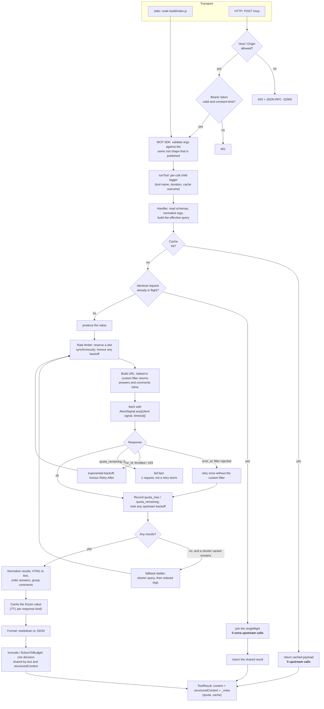

# Architecture

How a request travels through this server, where the process-wide state lives, and why
the boundaries are drawn where they are. Decisions with alternatives are recorded as
ADRs in [`docs/adr/`](./adr).

## Module map

| Module | Responsibility | Lines |
|---|---|---|
| `src/index.ts` | Executable shim. Imports `cli.ts`. Kept because the deployed systemd unit runs `node build/index.js`. | 13 |
| `src/cli.ts` | Process concerns only: suppress one transitive deprecation warning, read config, pick a transport, wire signals, own the shared state. No business logic, so importing any other module never starts a server. | 135 |
| `src/server.ts` | The `StackOverflowServer` class: tool/resource/prompt registration, the search pipeline, retry policy, cache read-through, tool handlers, response formatting. Re-exports the symbols other modules now own, so every suite keeps importing one path (ADR 0001). | 1928 |
| `src/config.ts` | **The only module that reads `process.env`.** Validates, defaults and documents all 17 server variables. `assertHttpConfigIsSafe()` refuses an unsafe bind. | 231 |
| `src/core/rateLimiter.ts` | Admission control: token bucket with a sliding window, a minimum delay between admissions, per-method `backoff`, synchronous slot reservation (fixes the concurrency bug this project started with). | 290 |
| `src/core/cache.ts` | LRU + TTL response cache with canonical keys, singleflight collapsing and frozen values. | 299 |
| `src/core/quota.ts` | Reads `quota_remaining`/`quota_max` out of every upstream response, computes the reset instant, and reports readiness. | 113 |
| `src/core/http.ts` | `redactSecrets`, `computeRetryDelayMs`, `retryAfterMs`, `sleep`. | 129 |
| `src/format/` | HTML to text, truncation that keeps JSON valid, output-shape constants, JSON and Markdown rendering. | 532 |
| `src/stackexchange/` | Query-variant ladder, error-message extraction and regex hardening, tag normalization and synonym resolution, the baked-in custom filter. | 312 |
| `src/tools/schemas.ts` | Single source for input constraints: the shape *published* to clients and the schema used to validate arguments come from one definition. | 224 |
| `src/transports/http.ts` | HTTP hardening: Host/Origin validation, constant-time bearer auth, body limit, session cap and idle TTL, per-IP limiting, deadline shutdown, `/health` and `/ready`. | 659 |
| `src/resources.ts`, `src/prompts.ts` | The two resources and three prompts. | 241 |
| `src/errors.ts` | Typed errors (`ValidationError`, `UpstreamError`, `QuotaExhaustedError`, `ThrottledError`, `TimeoutError`, `CancelledError`) and their MCP mapping. | 132 |
| `src/utils/logger.ts` | pino to **descriptor 2**. stdout is the stdio transport's data channel, so a log line there corrupts the protocol. | 57 |

## Request lifecycle

A tool call, from the transport to the response. The dotted edges are the paths that
make this server cheap to run: a cache hit, and the singleflight join.

## Process-wide state

Exactly four things live outside an instance, and all four are created once in `cli.ts`
and injected as `ServerDeps` (ADR 0002). Tests construct their own, which is why they
never see each other's state.

| State | Why it is process-wide |
|---|---|
| `RateLimiter` | Stack Exchange throttles per IP. Two sessions from one process share one IP, so a per-session limiter would double the effective rate. |
| `ResponseCache` | Quota is the scarcest resource. Two clients asking the same question should cost one request. |
| `QuotaTracker` | `quota_remaining` is a property of the IP (or API key), not of a session. |
| Logger | One destination (fd 2) and one redaction list. |

## Why the API-call budget is what it is

The budget is the design constraint, not a side effect. Full table in `PROGRESS.md`;
the shape of it:

| Tool | Upstream calls |
|---|---|
| `search_by_error`, `analyze_stack_trace`, `search_by_query` | **1** typical, up to 2 with a fallback |
| `search_by_tags` | 1, plus 1 lazy synonym lookup per new tag set |
| `search_by_question_id` | 1 (question and answers inline) |
| Any repeat of an identical call within TTL | **0** |
| Any concurrent duplicate | 1 shared (singleflight) |

Three things make that possible:

1. **A baked-in custom filter** (`src/stackexchange/filters.ts`) that returns answers
   and comments inline, replacing the per-result answers call and the vectorized comments
   call. Filters are immutable and non-expiring, so this costs one request once, ever
   (ADR 0003).
2. **The cache with singleflight**, so popularity is free.
3. **Honest failure**: an exhausted quota fails after one request instead of retrying
   into the wall, and `backoff` from the API is honoured per method.

## Error handling

`src/errors.ts` defines one type per failure mode, each carrying enough information to
decide whether a retry can help:

| Error | Meaning | Retried? |
|---|---|---|
| `ValidationError` | The arguments failed the schema. | Never — the caller must fix them. |
| `QuotaExhaustedError` | `quota_remaining` is 0; a retry cannot succeed before the daily reset. | Never. |
| `ThrottledError` | Stack Exchange throttled us (`error_id` 502 or HTTP 429). | Yes, honouring `backoff`/`Retry-After`. |
| `TimeoutError` | The request exceeded `REQUEST_TIMEOUT_MS`. | Yes, with exponential backoff. |
| `CancelledError` | The client cancelled (`extra.signal`). | Never. |
| `UpstreamError` | Anything else from the API (5xx, malformed body). | Yes, bounded. |

Cancellation is threaded as `AbortSignal.any([clientSignal, AbortSignal.timeout(...)])`.
The cache's producers deliberately take **no** caller signal: a shared singleflight result
must not be cancellable by whichever caller happened to start it. Each caller races the
shared promise against its own signal instead.

## Output contract

Every tool returns text (`content`) **and** `structuredContent`, with `outputSchema`
declared. The MCP SDK enforces the schema: a successful result without
`structuredContent` is a protocol error, and error results are exempt.

Text and structured output share one truncation decision (`fitJsonToBudget`), so they can
never disagree about which rows were dropped. `pagination.totalCount` is omitted unless the
API reported a real total, because presenting the page size as a total made clients believe
a page was the whole result set.

## Tests

33 suites, 262 tests, no network. The suites that are load-bearing beyond their own
subject:

| Suite | What it pins |
|---|---|
| `contract.test.ts` + its snapshot | The full published surface: tool names, parameter schemas, resources, prompts. The compatibility tripwire for every change. |
| `fetchCounts.test.ts` | The exact number of upstream requests per tool invocation. |
| `formattingFidelity.test.ts` | Produced payload bytes, so a refactor cannot quietly alter output. |
| `apiCallReduction`, `batching`, `cache`, `cacheIntegration`, `sharedState`, `quota` | The budget claims above. |
| `redos.test.ts` | Adversarial inputs against every regex, time-bounded. |
| `config.test.ts` | `config.ts` is the only `process.env` reader, and the README and config agree in both directions. |
| `packaging.test.ts` | The properties of the published package and the deployment artifacts. |
| `scripts/smoke.mjs` | The real process, real sockets, real stdio — including what jest cannot boot reliably in-process. |
